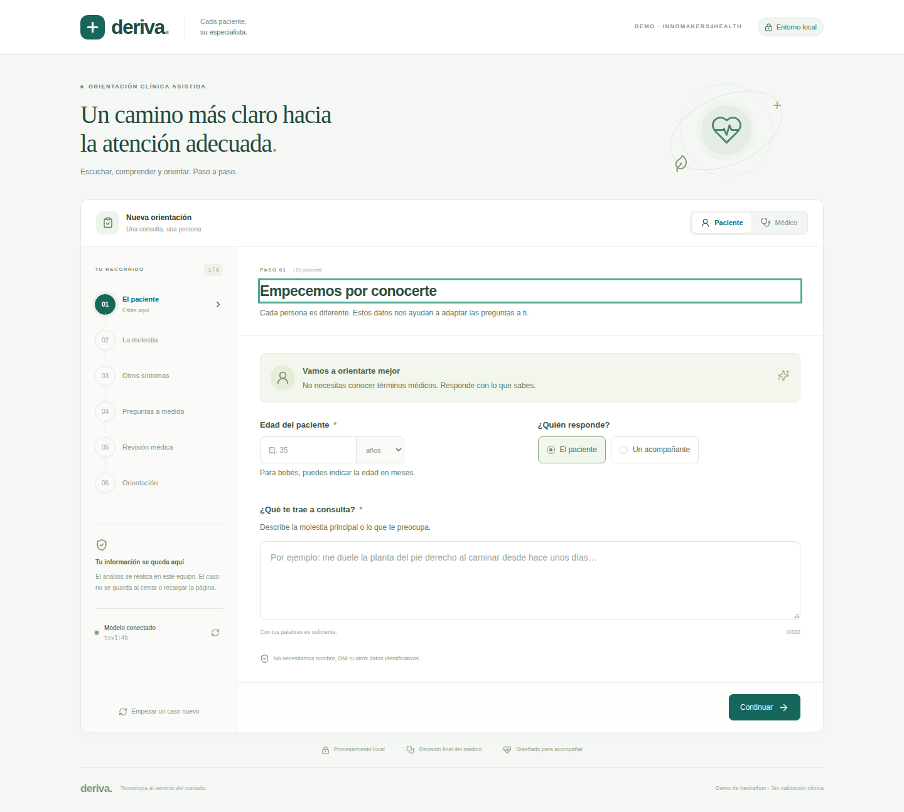

# Deriva · Cada paciente, su especialista

Aplicación web local de apoyo a la derivación hospitalaria, creada para **Innomakers4Health 2026**. Un formulario visual recoge la información de pacientes adultos y menores; `tev1:4b`, ejecutado en Ollama en este equipo, selecciona preguntas adicionales y clasifica 23 destinos para revisión del médico.

**Demo de hackathon, sin validación clínica.** Los porcentajes son puntuaciones del modelo entre las opciones ofrecidas: no equivalen a probabilidades de enfermedad, certeza diagnóstica ni garantía de una derivación correcta. La decisión corresponde al profesional médico.

## Inicio rápido

Necesitas Linux, Docker Engine con Compose, `make`, espacio para las imágenes y un Ollama compatible con `/v1/systemone`. Debes instalar `tev1:4b` por tu cuenta. La aplicación no descarga ni sustituye modelos.

```sh
cp .env.example .env
make
```

Abre **http://localhost:8080**. La imagen contiene el frontend y el backend; Compose usa la red del anfitrión para acceder a Ollama en `http://127.0.0.1:11434`. El servicio escucha solo en loopback. La compilación necesita conexión para descargar dependencias y el tokenizador público; el uso posterior de la aplicación es local.

```sh
make test        # Pruebas de backend y frontend en contenedores aislados
make test-live   # Dos recorridos ficticios contra el Tev real; requiere make up
make logs        # Logs del servicio, sin registro de cuerpos clínicos
make down       # Detener
make help       # Todos los objetivos
```

Si cambias `APP_PORT` en `.env`, utiliza ese puerto al abrir la aplicación. Consulta [instalación](docs/installation.md) para otros valores y para desarrollo sin Docker.

## Qué incluye



- Modos paciente y médico en el mismo navegador; sin registro ni cuentas.
- Formulario por pasos, mapa corporal frontal/posterior con lateralidad, selección múltiple, dolor de 0 a 10 y respuestas «no sé».
- Ramas por edad, preguntas pediátricas obligatorias y hasta ocho preguntas adicionales.
- Historial opcional pegado o cargado desde `.txt`/`.md` UTF-8, editable antes del análisis.
- Revisión médica explícita, alertas prioritarias y puntuaciones descendentes para las 20 especialidades, Atención Primaria, Urgencias y un destino no concluyente.
- Resumen imprimible y descargable. Caso exclusivamente en memoria: recargar, cerrar o iniciar otro caso elimina los datos de la aplicación.

## Documentación técnica

| Documento | Contenido |
| --- | --- |
| [Instalación y configuración](docs/installation.md) | Docker, Makefile, variables, desarrollo local y conectividad |
| [Arquitectura](docs/architecture.md) | Componentes, responsabilidades, flujo de datos y decisiones técnicas |
| [Contrato de API](docs/api.md) | Rutas, entradas, respuestas y errores |
| [Formulario adaptativo](docs/adaptive-form.md) | Reglas, edades, mapa, dependencias y finalización |
| [Integración con Tev](docs/tev.md) | API real, tokenización, porcentajes y tiempos de espera |
| [Privacidad](docs/privacy.md) | Memoria, logs, archivos, exportación y límites del modo médico |
| [Límites clínicos](docs/clinical-limits.md) | Interpretación, señales ilustrativas y validación pendiente |
| [Pruebas](docs/testing.md) | Pruebas aisladas, navegador y comprobación real |
| [Validación realizada](docs/validation.md) | Resultados observados y limitaciones de verificación |
| [Resolución de problemas](docs/troubleshooting.md) | Ollama, disco, contexto, Docker y errores recuperables |
| [Contribución](docs/contributing.md) | Organización, comentarios de funciones y cambios de catálogo |

## Estructura

```text
backend/       FastAPI, contratos, catálogo y adaptador de Ollama
frontend/      React + TypeScript + Vite, pruebas unitarias y de navegador
tests/         Pruebas de contrato y reglas del backend
examples/      Casos y un historial exclusivamente ficticios
scripts/       Preparación del tokenizador y comprobación real
docs/          Documentación técnica indexada
Dockerfile     Compilación multietapa y ejecución sin privilegios
compose.yaml   Aplicación local y servicios de pruebas
Makefile       Operaciones de construcción, ejecución y limpieza
```

Licencia: [MIT](LICENSE). Los modelos y dependencias conservan sus licencias propias.
