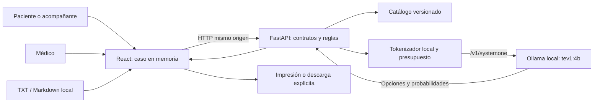

# Arquitectura

[Volver al README](../README.md)

## Componentes

- **React/TypeScript:** conserva el caso en estado de componentes, muestra las preguntas, invalida dependencias y gestiona peticiones cancelables. No utiliza cookies, almacenamiento web ni base de datos.
- **FastAPI/Pydantic:** valida todas las entradas, aplica prioridades y mínimos pediátricos, construye peticiones y valida las distribuciones del modelo. No conserva casos entre peticiones.
- **Catálogo Python:** define preguntas, condiciones, opciones y 23 destinos. Un único catálogo se expone al navegador para evitar copias incompatibles.
- **Adaptador HTTPX:** llama exclusivamente a la API de decisión configurada, con tiempo límite y sin reutilizar contenido clínico.
- **Tokenizador:** permite rechazar un contexto largo antes de transmitirlo. La imagen lo prepara durante la compilación.

## Flujo y cambios de respuestas

El navegador envía el caso completo en cada petición. El servidor no asigna identificadores de paciente ni mantiene sesiones. Antes de clasificar, el médico revisa el resumen y marca la confirmación. El modo médico es una vista de demostración, no una identidad autenticada.

Cambiar una respuesta cancela las peticiones pendientes, revoca la revisión y elimina cualquier resultado anterior. Cambiar la edad reinicia todas las preguntas adicionales para reservar espacio a los mínimos pediátricos. Al cambiar síntomas o localización, se eliminan las respuestas que dejan de ser elegibles y se conservan las pertinentes. Tev recibe el estado actualizado en la siguiente consulta.

Las señales de alarma afirmativas tienen prioridad y devuelven una indicación sin clasificación porcentual. Una respuesta «no sé» produce una advertencia para revisión, sin declarar por ello que el caso es seguro.

## Empaquetado

Docker utiliza etapas de dependencias, pruebas y compilación. La etapa final contiene Python, el backend, el tokenizador y los recursos estáticos de Vite. Un único proceso Uvicorn sirve la web y la API. El indicador de salud del contenedor comprueba el servicio web; `/api/health` comprueba por separado la disponibilidad del modelo.

No hay conexión con sistemas hospitalarios, autenticación de profesionales, persistencia ni publicación externa en esta versión.
